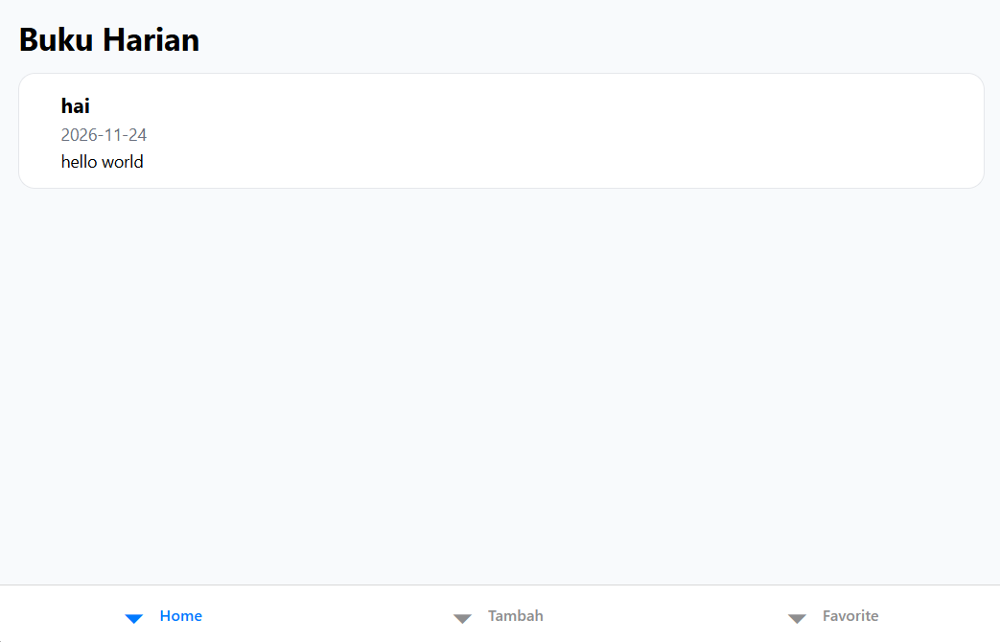
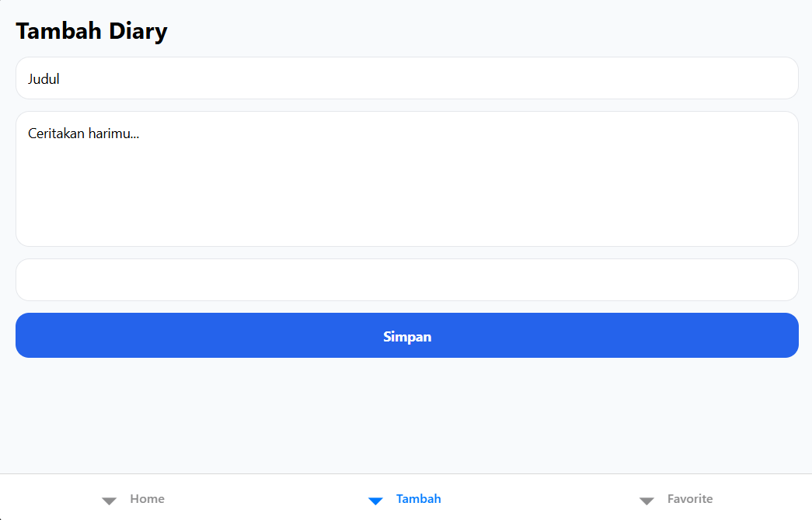
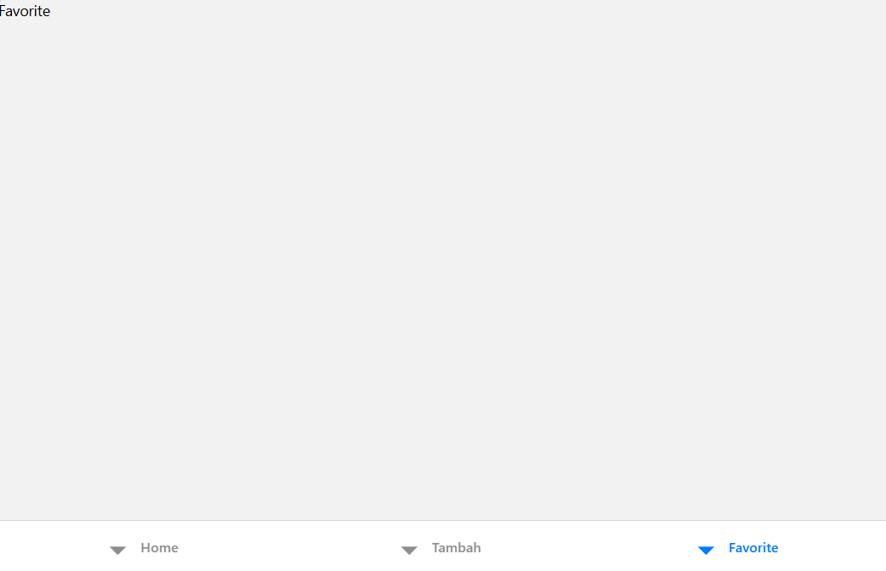
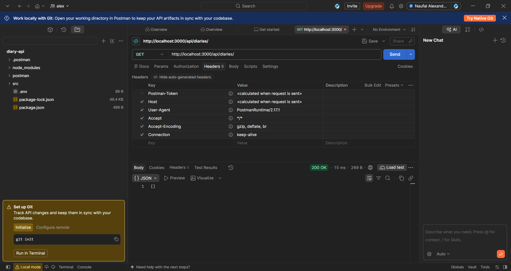
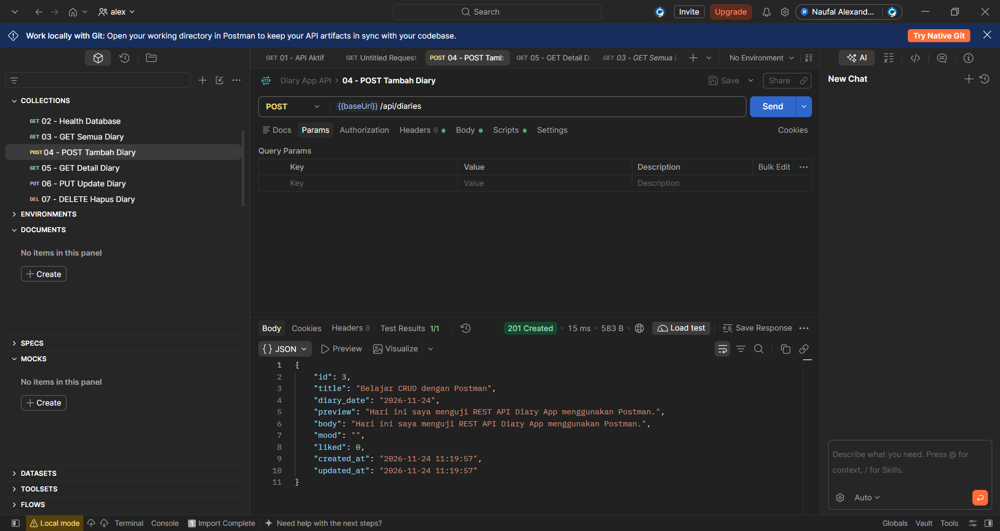
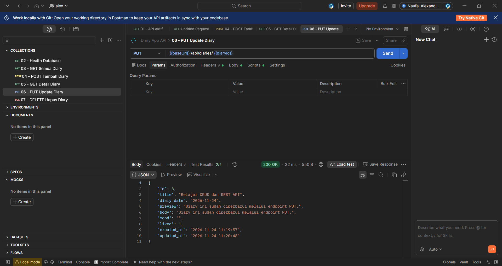
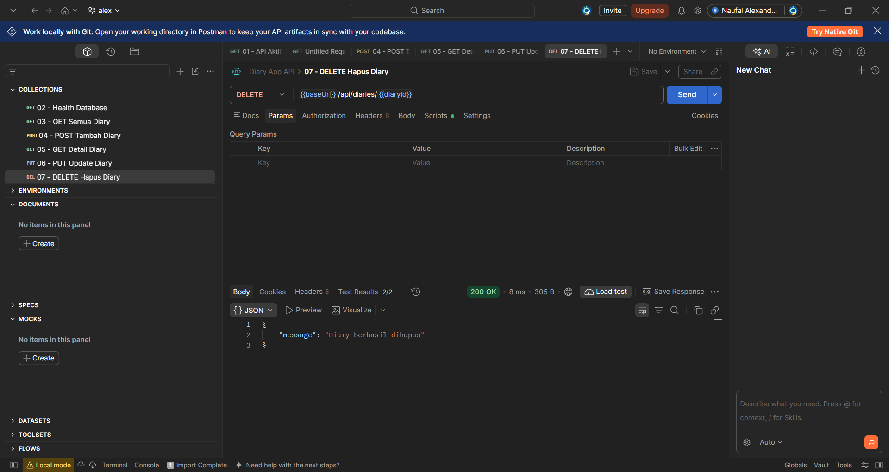
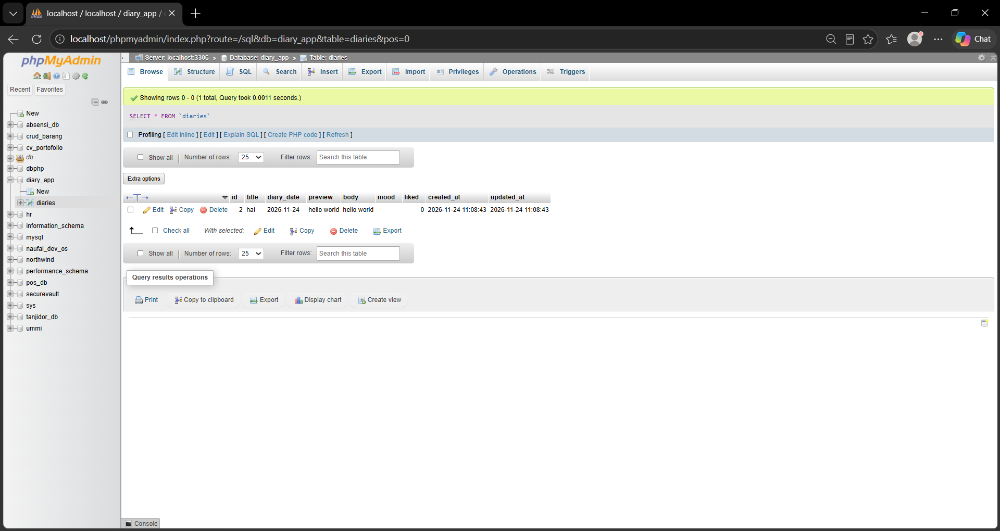

# Diary App 9

Aplikasi diary sederhana berbasis React Native dengan Expo Router, Redux Toolkit, REST API Express.js, dan MySQL.

Project ini terdiri dari dua bagian:

- `diary-api`: backend REST API menggunakan Express.js dan MySQL.
- `diary-app9`: aplikasi mobile React Native menggunakan Expo Router dan Redux Toolkit.

## Teknologi

- React Native
- Expo Router
- Redux Toolkit dan React Redux
- Node.js dan Express.js
- MySQL/MariaDB melalui Laragon
- Fetch API

## Struktur Project

```text
diary-app9/
├── diary-api/
│   ├── src/
│   │   ├── config/database.js
│   │   ├── controllers/diary.controller.js
│   │   ├── routes/diary.routes.js
│   │   └── server.js
│   └── postman/Diary App API.postman_collection.json
├── diary-app9/
│   ├── app/
│   │   ├── (tabs)/
│   │   ├── detail/[id].tsx
│   │   └── edit/[id].tsx
│   └── src/
│       ├── components/
│       ├── features/diary/
│       ├── redux/
│       ├── services/
│       └── styles/
├── ss1.png ... ss8.png
└── README.md
```

## Persiapan Database

Pastikan Laragon dan MySQL/MariaDB sedang berjalan. Buat database `diary_app` dan tabel `diaries` sesuai modul praktikum.

Konfigurasi backend tersedia pada [diary-api/.env.example](./diary-api/.env.example). Salin menjadi `.env`:

```powershell
cd diary-api
Copy-Item .env.example .env
```

Sesuaikan `DB_USER`, `DB_PASSWORD`, dan `DB_PORT` jika konfigurasi MySQL berbeda.

## Menjalankan Backend

```powershell
cd diary-api
npm install
npm run dev
```

Backend berjalan pada `http://localhost:3000`.

## Menjalankan Aplikasi React Native

Konfigurasi mobile tersedia pada [diary-app9/.env.example](./diary-app9/.env.example). Salin menjadi `.env` dan gunakan IPv4 laptop yang menjalankan backend:

```powershell
cd diary-app9
Copy-Item .env.example .env
npm install
npx expo start -c
```

HP dan laptop harus berada pada jaringan Wi-Fi/LAN yang sama ketika aplikasi dijalankan melalui Expo Go.

## Fitur Mobile

- Menampilkan daftar diary dari MySQL melalui REST API.
- Menambahkan diary baru.
- Melihat detail diary.
- Mengubah diary.
- Menghapus diary.
- Pull to refresh pada halaman utama.
- Loading, error, dan empty state.

## Endpoint REST API

| Method | Endpoint | Fungsi |
|---|---|---|
| GET | `/` | Mengecek API aktif |
| GET | `/health` | Mengecek koneksi database |
| GET | `/api/diaries` | Mengambil semua diary |
| GET | `/api/diaries/:id` | Mengambil detail diary |
| POST | `/api/diaries` | Menambahkan diary |
| PUT | `/api/diaries/:id` | Memperbarui diary |
| DELETE | `/api/diaries/:id` | Menghapus diary |

## Pengujian dengan Postman

Collection Postman tersedia di [diary-api/postman/Diary App API.postman_collection.json](./diary-api/postman/Diary%20App%20API.postman_collection.json).

Import file tersebut ke Postman, lalu jalankan request sesuai urutan. Request POST akan menyimpan `diaryId` secara otomatis untuk request GET detail, PUT, dan DELETE.

## Dokumentasi Screenshot

### 1. Halaman Home



### 2. Halaman Tambah Diary



### 3. Halaman Favorite



### 4. GET Semua Diary di Postman



### 5. POST Tambah Diary di Postman



### 6. PUT Update Diary di Postman



### 7. DELETE Diary di Postman



### 8. Data Diary pada Database MySQL



